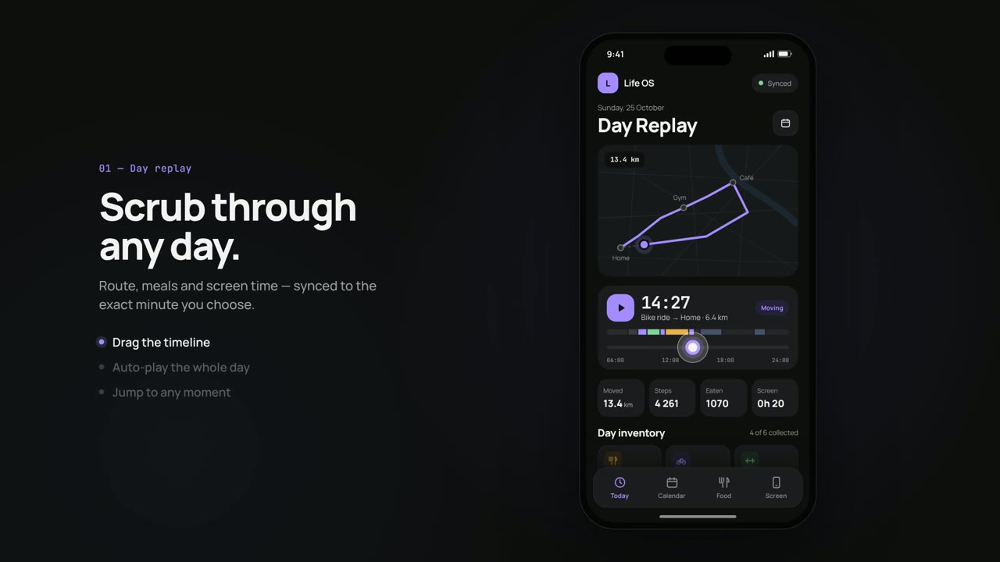

# Life OS

A personal life log. Scrub one slider through any day and replay it: the GPS route, stops, steps and how you travelled, all on a map. You can think of it as a match replay for your own day.



## Architecture

```
iPhone                                  old Android phone (Termux)             laptop
──────                                  ──────────────────────────             ──────
Overland (background GPS) ─POST /overland─▶  Node.js API (Fastify)  ◀─GET /day─  React web app
Shortcuts (Apple Health)  ─POST /samples──▶  PostgreSQL                          (Vite + Leaflet)
                                  └──────── private Tailscale network ────────┘
```

- **The phone is the server.** A retired Android phone runs Node.js and PostgreSQL in Termux. Everything starts on boot (Termux:Boot), and a nightly `pg_dump` keeps 14 days of backups.
- **Tailscale** connects the devices, so nothing is exposed to the public internet.
- **Every API call needs a token** (`Authorization: Bearer …`).

## API (`api/server.js`)

| Method | Path | What it does |
|---|---|---|
| `GET` | `/health` | liveness check |
| `POST` | `/overland` | batch of GPS points from Overland, one `INSERT … unnest` and `ON CONFLICT DO NOTHING` |
| `GET` | `/day?date=YYYY-MM-DD` | all points of a day (local time zone) |
| `GET` | `/days` | days that have any data |
| `POST` | `/samples` | interval data (steps, …). Each batch replaces its own time range in a transaction, so re-sent hours are not counted twice |
| `GET` | `/samples?date=YYYY-MM-DD` | intervals that touch that day |

Schema: [`api/schema.sql`](api/schema.sql). It has two tables, `locations` (GPS, unique by timestamp) and `samples` (`type`, `start`, `end`, `value`). The schema is idempotent and is applied on every deploy.

## Web app (`web/`)

React 19 + Vite + react-leaflet.

- **`geo.js`:** filters GPS noise, detects stops (60 m / 10 min), finds gaps, guesses the travel mode, and computes stats for the current moment.
- **`useReplay.js`:** the time slider and auto-play.
- **`metrics.js`:** a registry of tiles and events. A new data source (food, screen time…) plugs in here.
- **RU / EN** interface.

## Run

```sh
# server (on the phone)
cd api && npm install
psql lifeos -f schema.sql
node server.js                 # reads the token from api/.token

# web (on the laptop)
cd web && npm install
printf 'LIFEOS_TOKEN=...\nLIFEOS_API=http://<server>:3000\n' > .env.local
npm run dev                    # http://localhost:5173, /api is proxied with the token
```

`deploy.sh` pulls the latest code on the phone, applies the schema, restarts the API and checks `/health`.
